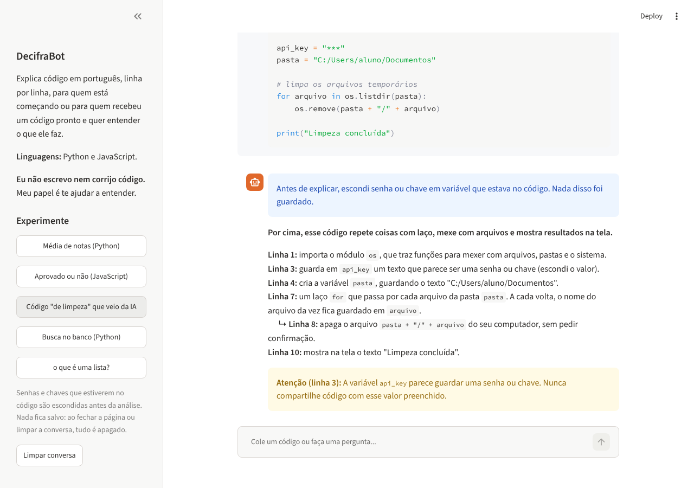

# DecifraBot

Hoje muita gente pede para uma IA gerar um código e usa o resultado sem saber o que ele faz. O DecifraBot vai no caminho contrário: a pessoa cola um código e ele explica, em português simples, o que cada linha faz. Também serve para quem achou um código interessante por aí e quer entender como ele funciona.

Projeto final da Unidade IV (Agentes e Ética) da disciplina Tendências em Ciência da Computação.

| | |
|---|---|
| **Aluno** | Davi Vieira Lima |
| **RGM** | 39538061 |
| **Professora** | Kadidja Valéria |
| **Instituição** | UDF Centro Universitário |
| **Ferramenta de IA usada como apoio** | Claude |

**Versão online:** https://davilima11.github.io/DecifraBot/ (dá para usar e ler a documentação direto no navegador, sem instalar nada)



## O que ele faz

Explica código **Python** e **JavaScript** linha por linha, avisa quando o código faz algo que merece cuidado (apagar arquivos, mandar dados pela internet, montar SQL juntando texto, guardar senha no código) e responde perguntas sobre os conceitos que aparecem, como "o que é um for?". Depois de explicar, dá para pedir "explica a linha 4" ou "resume".

E o que ele **não** faz: não escreve nem corrige código, não executa o código e não guarda nada depois que a conversa acaba. Senhas e chaves que estiverem no código são escondidas antes de qualquer análise. Quando encontra algo que não sabe explicar, ele diz isso em vez de inventar.

## Como rodar

Precisa de Python 3.10 ou mais novo.

```bash
pip install -r requirements.txt
streamlit run app.py
```

Para abrir a versão web no computador (a mesma do site):

```bash
python -m http.server
# depois abra http://localhost:8000
```

Para rodar os testes:

```bash
python -m pytest
python -m tests.calibrar_limiar   # mostra como escolhi o limiar de confiança
```

## Onde está cada entrega

| Entrega da Unidade IV | Onde está |
|---|---|
| Criação de agente de IA | [docs/2-arquitetura-do-agente.md](docs/2-arquitetura-do-agente.md) e a pasta `decifra/` |
| Chatbot com a especificação | [docs/1-especificacao.md](docs/1-especificacao.md) e `app.py` |
| Viés algorítmico e responsabilidade social | [docs/3-etica-e-vies.md](docs/3-etica-e-vies.md) |
| Projeto final (solução aplicada) | este repositório, com os testes em [docs/4-testes.md](docs/4-testes.md) |

A documentação segue o fluxo de trabalho de chatbots do SERPRO, adaptado para o tamanho de um projeto de disciplina.

## Estrutura

```
app.py                        interface em Streamlit
index.html, web/              versão web: o mesmo código Python rodando no navegador (Pyodide)
decifra/
  agente.py                   as 4 camadas do agente (perceber, entender, decidir, executar)
  memoria.py                  memória curta e média
  linguagem.py                descobre se o código é Python, JavaScript ou outra linguagem
  privacidade.py              esconde senhas e chaves antes da análise
  tfidf.py                    TF-IDF feito à mão, para entender as perguntas
  textos.py                   frases de explicação compartilhadas entre as linguagens
  analisadores/python.py      lê Python com o módulo ast
  analisadores/javascript.py  lê JavaScript com a biblioteca esprima
data/conhecimento.json        conceitos, perguntas e respostas
data/exemplos.json            códigos de exemplo da tela
tests/                        testes com pytest e script de calibração
docs/                         especificação, arquitetura, ética e testes
```

## Tecnologias

Python, Streamlit, o módulo `ast` do próprio Python, a biblioteca `esprima` (para ler JavaScript) e pytest. A versão online usa o Pyodide, que roda Python dentro do navegador. Não usa API de IA nenhuma: o código da pessoa não sai do computador dela. O motivo dessa escolha está na arquitetura.

## Mais linguagens

Cada linguagem tem um analisador próprio, mas as frases de explicação ficam num arquivo só (`decifra/textos.py`) e são usadas pelas duas. Para ensinar Java ao DecifraBot, por exemplo, seria preciso um analisador novo que leia Java (a biblioteca `javalang` faz isso); o texto das explicações já está quase todo pronto.
